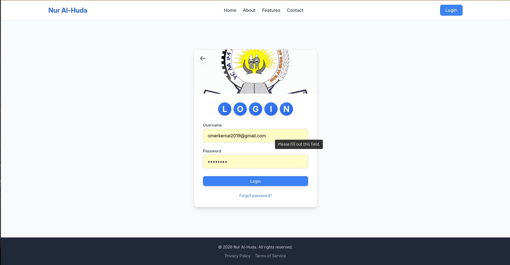
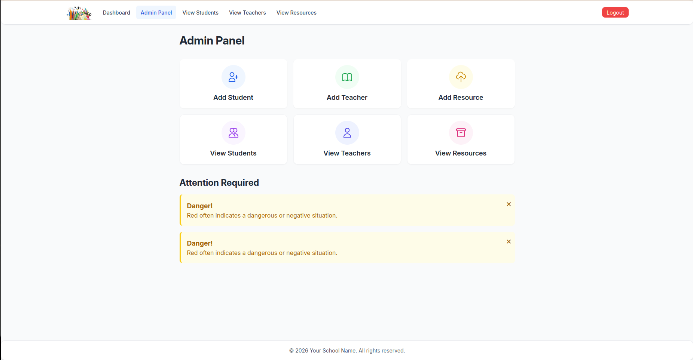
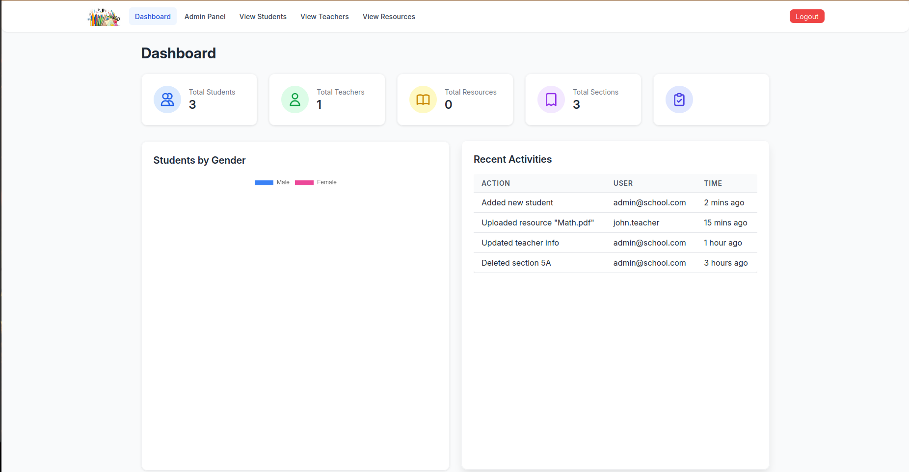

# PSLMS

<p align="center">
  
</p>

**PSLMS (Primary School Learning Management System)** is a Flask application for managing students, teachers, parents, assessments, subjects, resources, semesters, and in-app school reports.

The project uses SQLite and SQLAlchemy for local data storage and a role-based interface for administrators, teachers, students, parents, and public visitors.

---

## Features

### Public

- Public home page
- About page
- Login and logout
- Role-based access to protected areas

### Administrator

- Dashboard with recent activity and attention items
- Create, view, update, and delete students
- Reset student passwords
- Create, view, update, and delete teachers
- Assign and remove teacher subjects
- Create and manage class sections
- Create, view, update, and delete parents
- Link parents to students
- Upload and delete class resources
- Configure resource types and assessment deadlines
- Create and manage semesters
- Generate and view semester reports
- Automatically publish reports after semester end dates

### Teacher

- Teacher dashboard
- View assigned classes
- View students in a class
- Create assessments
- Submit and update student grades
- Calculate and view class ranks
- Upload and view resources
- Generate parent grade alerts when subject averages fall below 50%
- Generate improvement alerts when averages rise above 50%

### Student

- Student dashboard
- View grades by semester
- View subject averages and class grades
- View available resources
- Update profile information

### Parent

- Parent dashboard
- View each linked child
- View child grades by semester
- View grade-attention and improvement alerts
- View published semester reports
- View resources
- Update parent profile information

### Semester and reporting

- Semesters have names, start dates, and end dates
- Administrators can update semester details
- New assessments can be assigned to the active semester
- Older assessments without semester information remain unassigned
- Subject averages are calculated per semester
- Reports contain subject averages and attention counts
- Expired semesters are published automatically on the next authenticated request

---

## Technology

| Technology | Purpose |
|---|---|
| Python | Application language |
| Flask | Web framework |
| Flask-Login | Session and authentication support |
| SQLAlchemy | SQLite database models and queries |
| SQLite | Local application database |
| Jinja2 | Server-side HTML templates |
| HTML, CSS, and JavaScript | User interface |
| unittest | Automated tests |
| filelock | Safe access to log and lock files |
| openpyxl | Spreadsheet-related data support |

---

## Project structure

```text
pslms/
├── app.py                 # Flask application and blueprint setup
├── init.py                # Database, directory, admin, and subject setup
├── init.sh                # Initialization and application start script
├── requirements.txt       # Python dependencies
├── admin/                 # Administrator routes and templates
├── teacher/               # Teacher routes and templates
├── student/               # Student routes and templates
├── parent/                # Parent routes and templates
├── login/                 # Login routes and templates
├── public/                # Public pages
├── event/                 # Success, error, and authorization pages
├── database/              # SQLAlchemy models and database setup
├── utility/               # Configuration and shared helpers
├── data/                  # SQLite database, memory data, and logs
├── static/                # CSS, JavaScript, images, and uploaded resources
├── tests/                 # Focused unittest coverage
└── screen_shoots/         # Project screenshots
```

---

## Requirements

- Python 3.8 or newer
- `pip`
- Git

The application is configured for SQLite, so no separate database server is required.

---

## Installation

### 1. Clone the repository

```bash
git clone https://github.com/omerKkemal/pslms.git
cd pslms
```

### 2. Create and activate a virtual environment

Linux/macOS:

```bash
python3 -m venv venv
source venv/bin/activate
```

Windows:

```powershell
python -m venv venv
venv\Scripts\activate
```

### 3. Install dependencies

```bash
pip install -r requirements.txt
```

### 4. Initialize the application

```bash
python init.py
```

Initialization creates the required database directories and tables, creates the default administrator account, and can add the default subject list.

The setup prompt asks whether to insert default subjects. Enter `y` to add them or `n` to skip this step.

---

## Running the application

```bash
python app.py
```

Open:

```text
http://127.0.0.1:5000/
```

Flask debug mode is enabled when the application is started directly through `app.py`.

To initialize and then start the project with the shell script on Linux or macOS:

```bash
bash init.sh
```

---

## Default administrator account

The initialization setup creates an administrator account. The default values are defined in `utility/setting.py`:

```text
Username: admin
Password: admin
```

Change these defaults before using the application outside a local or test environment. After logging in, use the password-reset and account-management options to secure all user accounts.

---

## Main routes

| Area | Routes |
|---|---|
| Public | `/`, `/about` |
| Authentication | `/login`, `/logout` |
| Administrator | `/admin/Dashboard`, `/admin/panal`, `/admin/reports` |
| Students | `/admin/panal/add_students`, `/admin/panal/get_students/<grade>/<section>` |
| Teachers | `/admin/panal/add_teacher`, `/admin/panal/get_teachers` |
| Parents | `/admin/panal/get_parents` |
| Resources | `/add_resource`, `/view_resource`, `/admin/panal/delete_resource` |
| Teacher portal | `/teacher/dashboard`, `/teacher/classes`, `/teacher/assessment/create` |
| Student portal | `/student/dashboard`, `/student/grades`, `/student/resources`, `/student/profile` |
| Parent portal | `/parent/dashboard`, `/parent/grades`, `/parent/alerts`, `/parent/reports`, `/parent/resources` |

Protected routes require a valid login session. Role checks determine which portal and actions a user can access.

---

## Configuration and data

Application settings are configured in `utility/setting.py`, including:

- Flask secret key generation
- SQLite database location
- Log file location
- Memory JSON location
- Default administrator credentials
- Resource directories
- Allowed resource file extensions
- Resource types

The application stores runtime data under `data/`:

- `data/db/student.db` - SQLite database
- `data/db/memory.json` - grades/sections and temporary application memory
- `data/log/log.txt` - application event log

Existing installations start by adding missing semester, grade-alert, and report tables without deleting existing database records.

---

## Tests

Run the focused test suite from the project root:

```bash
python -m unittest discover -s tests -v
```

The tests cover:

- Parent attention alerts
- Parent improvement alerts
- Semester-scoped subject averages
- Automatic expired-semester report publication
- Administrator resource uploads
- Configured resource types
- Memory-backed section values

---

## Screenshots

<div align="center">

| Home | Login |
|---|---|
|  |  |
| **Public home page** | **Login page** |

| Admin panel | Dashboard |
|---|---|
|  |  |
| **Administration** | **Application dashboard** |

</div>

---

## Security notes

This project is intended as a local or educational application. Before deployment:

- Replace the default administrator credentials
- Replace the runtime-generated secret key with a persistent environment-based secret
- Use a production WSGI server and HTTPS
- Add stronger password hashing and account policy
- Do not commit `.env`, databases containing real records, uploaded files, or log files
- Restrict access to configuration and data directories

---

## Contributing

1. Fork the repository.
2. Create a feature branch.
3. Make focused code and documentation changes.
4. Run the tests.
5. Open a pull request.

## License

See [LICENSE](LICENSE) for the project license.

## Author

**Omer Kemal**

- GitHub: [omerKkemal](https://github.com/omerKkemal)
