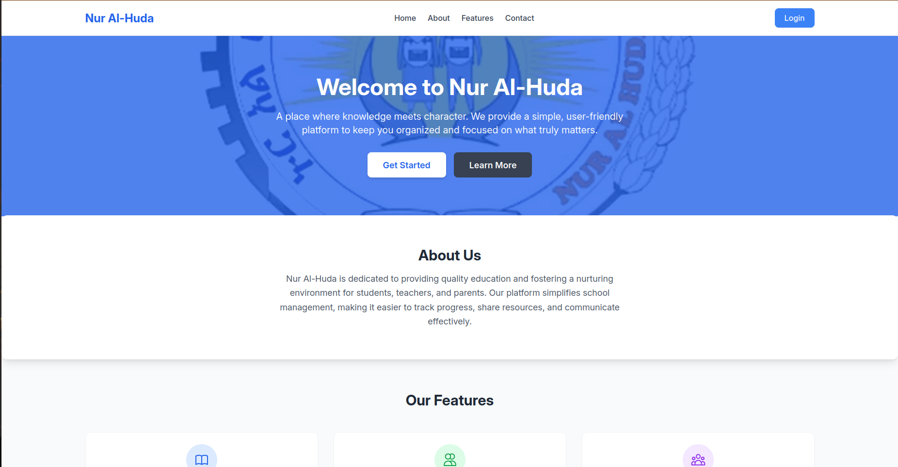

# PSLMS — Primary School Learning Management System

> **Because managing a school shouldn't be easy, but at least it can be sarcastic.**

<p align="center">
  
</p>

<p align="center">
  
  
  
  
  
</p>

**PSLMS** is a Flask application for managing students, teachers, parents, assessments, subjects, resources, semesters, and in-app school reports. It uses SQLite and SQLAlchemy for local data storage and a role‑based interface for administrators, teachers, students, parents, and public visitors.

> **Disclaimer:** This is a school management system. Not a social network. Not a game. Not a place to share memes (unless you upload them as resources). You're welcome.

---

## Table of Contents

- [Features](#features-or-what-it-pretends-to-do)
  - [Public](#public)
  - [Administrator](#administrator)
  - [Teacher](#teacher)
  - [Student](#student)
  - [Parent](#parent)
  - [Semester and reporting](#semester-and-reporting)
- [Technology](#technology-because-people-ask)
- [Project structure](#project-structure-where-files-go-to-live)
- [Requirements](#requirements-dont-skip-this)
- [Installation](#installation-the-fun-part)
- [Running the application](#running-the-application-fingers-crossed)
- [Default administrator account](#default-administrator-account-change-it-seriously)
- [Main routes](#main-routes-where-you-can-go)
- [Configuration and data](#configuration-and-data-where-magic-happens)
- [Tests](#tests-because-we-have-standards)
- [Screenshots](#screenshots-because-you-cant-read)
- [Security notes](#security-notes-please-read-this)
- [Contributing](#contributing-or-how-to-annoy-me)
- [License](#license)
- [Author](#author)

---

## Features (Or: What It Pretends To Do)

### Public
- **Public home page** – Because even strangers need to see your school's logo.
- **About page** – A page about the school. Riveting stuff.
- **Login and logout** – The gateway to chaos. Logging out is optional.
- **Role‑based access to protected areas** – So students can't delete the database. On purpose, anyway.

### Administrator
- **Dashboard with recent activity and attention items** – So you can pretend you're in control.
- **Create, view, update, and delete students** – Like Pokémon, but with more paperwork.
- **Reset student passwords** – Because they will forget them. All of them.
- **Create, view, update, and delete teachers** – They also forget passwords.
- **Assign and remove teacher subjects** – The political part of school management.
- **Create and manage class sections** – Because alphabetical order is too easy.
- **Create, view, update, and delete parents** – They're people too. Allegedly.
- **Link parents to students** – Parent trap, but with SQL.
- **Upload and delete class resources** – PDFs, images, and that one suspicious .zip.
- **Configure resource types and assessment deadlines** – Rules, rules, rules.
- **Create and manage semesters** – Time is an illusion. Semesters are not.
- **Filter grade reports by grade, section, semester, and assessment type** – A little less scrolling.
- **Open and print student report cards** – All assessment scores, averages, ranks, and parent alert history in one place.
- **Calculate class ranks from semester averages** – Admins only, from the grade reports page.
- **Automatically publish reports after semester end dates** – Like expired milk, but with more data.

### Teacher
- **Teacher dashboard** – A dashboard for teachers. Shocking.
- **View assigned classes** – The ones you're actually teaching. Remember?
- **View students in a class** – Faces with names and grades.
- **Create assessments** – Tests, quizzes, or whatever you call them this week.
- **Record grades from your created-assessment dropdown and update specific scores** – Assessment names stay consistent.
- **See student-level missing midterm/final grade notices after deadlines** – NG means a required score has not been recorded.
- **Record or update the missing assessment score** – Fill in the gap from the class grading sheet.
- **Upload and view resources** – Share your knowledge. Or your confusion.
- **Alert parents when any assessment score is below 50%** – Alerts show the assessment name and percentage.
- **Record assessment recoveries and subject-average improvements** – Parents can see when results improve.

### Student
- **Student dashboard** – Your personal corner of academic anxiety.
- **View grades by semester** – Or avoid looking at them. Your choice.
- **View subject averages and class grades** – The numbers that define your worth (just kidding... mostly).
- **View available resources** – Useful stuff, if you bother to download it.
- **Update profile information** – Change your profile picture to something less embarrassing.

### Parent
- **Parent dashboard** – Where you can check up on your child without actually talking to them.
- **View each linked child** – All of them. Even the one you forgot about.
- **View child grades by semester** – Brace yourself.
- **View grade‑attention and improvement alerts** – The automated guilt trips.
- **View published semester reports** – Proof that your kid is actually doing something.
- **View resources** – Educational materials. Or memes in disguise.
- **Update parent profile information** – So you can pretend you're tech‑savvy.

### Semester and reporting
- **Semesters have names, start dates, and end dates** – Time is real.
- **Administrators can update semester details** – Fix the dates you got wrong.
- **New assessments can be assigned to the active semester** – The ongoing one.
- **Older assessments without semester information remain unassigned** – Orphan assessments. Sad.
- **Subject averages are calculated per semester** – Because math is fun.
- **Reports contain subject averages and attention counts** – Numbers, numbers, numbers.
- **Report cards include assessment scores and parent alert history** – Including later improvement for the same assessment or subject average in the same semester.
- **Class ranks are calculated per semester from subject averages** – Started by an administrator from grade reports.
- **Expired semesters are published automatically on the next authenticated request** – Magic? No, just code.

---

## Technology (Because People Ask)

| Technology | Purpose |
|---|---|
| Python | Application language – because we're not savages. |
| Flask | Web framework – lightweight, like my will to live. |
| Flask‑Login | Session and authentication support – so you can log in and forget your password. |
| SQLAlchemy | SQLite database models and queries – ORM magic. |
| SQLite | Local application database – small, fast, and easy to lose. |
| Jinja2 | Server‑side HTML templates – because templating is nice. |
| HTML, CSS, and JavaScript | User interface – the pretty bits. |
| unittest | Automated tests – sometimes they pass. |
| filelock | Safe access to log and lock files – so logs don't get corrupted (fingers crossed). |
| openpyxl | Spreadsheet‑related data support – for the Excel‑inclined. |

---

## Project Structure (Where Files Go To Live)

```text
pslms/
├── app.py                 # Flask application and blueprint setup – the start button
├── init.py                # Database, directory, admin, and subject setup – the setup wizard
├── init.sh                # Initialization and application start script – for the lazy
├── requirements.txt       # Python dependencies – the list of things you need
├── admin/                 # Administrator routes and templates – where the power is
├── teacher/               # Teacher routes and templates – where the grading happens
├── student/               # Student routes and templates – where the confusion is
├── parent/                # Parent routes and templates – where the questions are
├── login/                 # Login routes and templates – the gatekeeper
├── public/                # Public pages – for the unwashed masses
├── event/                 # Success, error, and authorization pages – where things go wrong
├── database/              # SQLAlchemy models and database setup – the data bits
├── utility/               # Configuration and shared helpers – the glue
├── data/                  # SQLite database, memory data, and logs – the brain
├── static/                # CSS, JavaScript, images, and uploaded resources – the pretty parts
├── tests/                 # Focused unittest coverage – the reality check
└── screen_shoots/         # Project screenshots – the proof
```

---

## Requirements (Don't Skip This)

- Python 3.8 or newer – because we're not stuck in 2015.
- `pip` – the package installer. You know it.
- Git – to clone the repo. Or download the ZIP. We won't judge. (We will.)
- The application is configured for SQLite, so no separate database server is required. Hooray for small victories.

---

## Installation (The Fun Part)

### 1. Clone the repository
```bash
git clone https://github.com/omerKkemal/pslms.git
cd pslms
```

### 2. Create and activate a virtual environment
Linux/macOS:
```bash
python3 -m venv venv
source venv/bin/activate
```
Windows:
```powershell
python -m venv venv
venv\Scripts\activate
```

### 3. Install dependencies
```bash
pip install -r requirements.txt
```

### 4. Initialize the application
```bash
python init.py
```

> **What happens next:** Initialization creates the required database directories and tables, creates the default administrator account, and asks whether to add the default subject list. Enter `y` to add them or `n` to skip. (It's not a trick question. It's a feature.)

---

## Running the Application (Fingers Crossed)

```bash
python app.py
```

Then open:
```text
http://127.0.0.1:5000/
```

Flask debug mode is enabled when you start it directly through `app.py`. Don't worry, it's just a debug mode. What could possibly go wrong?

On Linux or macOS, you can also use:
```bash
bash init.sh
```
(Which initializes and then starts the app, because we're efficient.)

---

## Default Administrator Account (Change It. Seriously.)

The initialization setup creates an administrator account. The default values are defined in `utility/setting.py`:

```text
Username: admin
Password: admin
```

> **Warning:** Change these before using the application outside a local or test environment. Because "admin/admin" is the digital equivalent of leaving your front door open with a sign that says "Please rob me." After logging in, use the password‑reset and account‑management options to secure all user accounts. Please. I'm begging you.

---

## Main Routes (Where You Can Go)

| Area | Routes |
|---|---|
| Public | `/`, `/about` |
| Authentication | `/login`, `/logout` |
| Administrator | `/admin/Dashboard`, `/admin/panal`, `/admin/reports` |
| Students | `/admin/panal/add_students`, `/admin/panal/get_students/<grade>/<section>` |
| Teachers | `/admin/panal/add_teacher`, `/admin/panal/get_teachers` |
| Parents | `/admin/panal/get_parents` |
| Resources | `/add_resource`, `/view_resource`, `/admin/panal/delete_resource` |
| Teacher portal | `/teacher/dashboard`, `/teacher/classes`, `/teacher/assessment/create` |
| Student portal | `/student/dashboard`, `/student/grades`, `/student/resources`, `/student/profile` |
| Parent portal | `/parent/dashboard`, `/parent/grades`, `/parent/alerts`, `/parent/reports`, `/parent/resources` |

Protected routes require a valid login session. Role checks determine which portal and actions a user can access. Because we're not animals.

---

## Configuration and Data (Where Magic Happens)

Application settings are configured in `utility/setting.py`, including:
- Flask secret key generation
- SQLite database location
- Log file location
- Memory JSON location
- Default administrator credentials
- Resource directories
- Allowed resource file extensions
- Resource types

The application stores runtime data under `data/`:
- `data/db/student.db` – SQLite database (your data lives here)
- `data/db/memory.json` – grades/sections and temporary application memory (the weird bits)
- `data/log/log.txt` – application event log (where errors go to die)

Existing installations add missing semester, grade‑alert, and report tables, plus the parent-password, alert-assessment, and semester-rank columns needed by current features. These migrations preserve existing database rows.

---

## Tests (Because We Have Standards)

Run the focused test suite from the project root:
```bash
python -m unittest discover -s tests -v
```

The tests cover:
- Parent attention alerts
- Parent improvement alerts
- Semester‑scoped subject averages
- Automatic expired‑semester report publication
- Administrator resource uploads
- Configured resource types
- Memory‑backed section values

> **Pro tip:** Run them. They might pass. They might not. It's a journey.

---

## Screenshots (Because You Can't Read)

<details>
<summary><b>Click to expand the gallery (and your expectations)</b></summary>

<br>

| Home | Login |
|---|---|
|  |  |
| **Public home page** – The digital front door. | **Login page** – Where dreams (and passwords) are made. |

| Admin panel | Dashboard |
|---|---|
|  |  |
| **Administration** – Where the magic (and chaos) happens. | **Application dashboard** – Numbers and graphs to make you feel productive. |

</details>

---

## Security Notes (Please Read This)

This project is intended as a local or educational application. Before deployment:

- Replace the default administrator credentials – **do it now**.
- Replace the runtime‑generated secret key with a persistent environment‑based secret – because secrets shouldn't be random.
- Use a production WSGI server and HTTPS – because HTTP is for cavemen.
- Add stronger password hashing and account policy – "password123" is not a strong password. Shockingly.
- Do not commit `.env`, databases containing real records, uploaded files, or log files – git is not a backup tool.
- Restrict access to configuration and data directories – because not everyone needs to see your database.

> **TL;DR:** This is not secure out of the box. It's a learning project. Don't put it on the internet. I'm warning you. I'm not responsible if you get hacked. Seriously.

---

## Contributing (Or: How to Annoy Me)

1. Fork the repository – go on, make your own copy.
2. Create a feature branch – name it something clever.
3. Make focused code and documentation changes – don't rewrite everything.
4. Run the tests – they might pass.
5. Open a pull request – and pray I don't ignore it.

---

## License

See [LICENSE](LICENSE) for the project license. It's probably MIT. Or not. I don't remember. (It's MIT, probably.)

---

## Author

**Omer Kemal**

- GitHub: [omerKkemal](https://github.com/omerKkemal)

> Made with coffee, sarcasm, and a deep sense of regret. You're welcome.

---

<p align="center">
  <sub><b>PSLMS: Because managing a school is hard. At least the code is honest.</b></sub><br>
  <sub>Built with Flask. Fueled by caffeine. Supported by sarcasm.</sub><br>
  <sub>No warranty. No refunds. No promises.</sub><br>
  <sub>Go outside. Touch grass. Or don't. I'm not your mom.</sub>
</p>